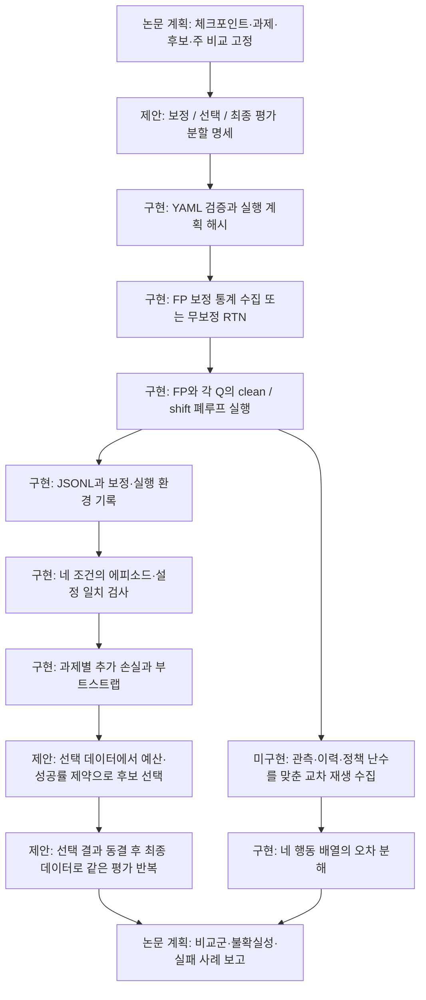

# VLAQuantShift

**환경이 달라졌을 때, VLA 모델의 양자화로 인한 성능 손실이 얼마나 더 커지는지 평가하는 연구 도구입니다.**

현재 보고 있는 브랜치는 **`korean` — 한국어 안내 버전**입니다. [영문 `main` 브랜치](https://github.com/ksyint/VLAQuantShift/tree/main)도 볼 수 있습니다.

[VLAQuantBench](https://github.com/jiuyixu25/VLAQuantBench)를 기반으로 개발했습니다. 원본 코드의 Git 이력, 라이선스, 저자 인용을 유지하며, 원 연구팀과는 독립적인 프로젝트입니다.

> **현재 진행 상태**
>
> 실험 코드, 분석 도구, 연구 계획과 논문 프로토콜 초안을 작성했습니다. 소형 합성 환경으로 실행을 검증했으며, **실제 VLA 모델의 대규모 실험과 논문 성능 결과는 아직 확보하지 않았습니다.** 기존 `results/`의 수치는 원 VLAQuantBench 연구진의 결과입니다.

## 먼저 어디를 보면 되나요?

| 하고 싶은 일 | 읽을 문서 |
| --- | --- |
| 프로젝트를 이해하고 직접 실행하기 | 이 README |
| 용어와 폴더 구조부터 이해하기 | [문서 안내와 용어 정리](docs/README.md) |
| 논문 아이디어·파이프라인·알고리즘·메소드 읽기 | [README 상세 연구 설계](#paper-methods) |
| 별도 연구 프로토콜 검토하기 | [연구 계획](docs/shift_research_plan.md) |
| 기존 논문과 겹치는 부분 확인하기 | [관련 연구·차별성 검토](docs/shift_related_work.md) |
| 논문 초안 읽기 | [논문 초안 안내](paper/README.md) |
| 실제로 어디까지 검증했는지 확인하기 | [검증 기록](verification/README.md) |
| 원본과 새 기여를 구분하기 | [출처와 수정 범위](UPSTREAM.md) |

## 핵심 아이디어

밝기나 노이즈가 바뀌면 원래 모델도 성능이 떨어질 수 있습니다. 따라서 양자화한 모델의 성공률만 비교하면 **환경 변화의 영향**과 **양자화의 영향**을 구분하기 어렵습니다.

같은 과제·초기 상태·난수 시드로 다음 네 조건을 실행합니다. 여기서 FP는 배포된 원래 정밀도, Q는 양자화한 정밀도를 뜻합니다.

| | 원래 관측 `clean` | 변화시킨 관측 `shift` |
| --- | --- | --- |
| 원래 정밀도 FP | `FP-clean` | `FP-shift` |
| 양자화 Q | `Q-clean` | `Q-shift` |

```text
원래 환경의 양자화 손실 = FP-clean 성공률 − Q-clean 성공률
변화 환경의 양자화 손실 = FP-shift 성공률 − Q-shift 성공률

환경 변화에 따른 추가 손실 = 변화 환경의 양자화 손실 − 원래 환경의 양자화 손실
```

예를 들어 **FP-clean 90%, Q-clean 88%, FP-shift 80%, Q-shift 70%**라면 양자화 손실은 2%p에서 10%p로 늘었으므로, 추가 손실은 **8%p**입니다. 이해를 위한 가상 예시이며 측정 결과가 아닙니다.

분석기는 성공률을 백분율이 아닌 비율로 기록합니다. 추가 손실 `0.08`은 **8%p**입니다. 추가 손실이 양수이면 해당 변화에서 양자화의 불이익이 더 커졌다는 뜻입니다. 다만 두 정책이 모두 실패하는 상황에서는 추가 손실이 작거나 음수가 될 수 있으므로, **네 조건의 성공률을 함께 확인해야 합니다.**

이 비교식 자체를 새로운 이론으로 주장하지 않습니다. 연구의 초점은 조건과 기록을 엄격하게 맞춘 실험으로 어떤 정밀도 설정이 환경 변화에 취약한지 확인하는 것입니다.

## 구현한 기능

- **관측 변화 적용:** 밝기, 픽셀 노이즈, 가림, 카메라 누락을 모델 전처리 전에 적용합니다.
- **재현 가능한 실행:** 에피소드별 시드와 실행 환경을 기록하고, 설정이 다른 실행 파일에 이어 쓰는 것을 막습니다.
- **보정·평가 분리:** 보정에 쓴 에피소드와 평가 에피소드의 인덱스 중복을 검사하고, 보정 캐시를 조건별로 구분해 해시를 남깁니다.
- **정확한 짝 비교:** 네 조건의 에피소드 누락·중복·설정 불일치를 오류로 처리합니다. 과제별 효과와 과제 단위 부트스트랩 신뢰구간을 계산합니다.
- **행동 오차 분석:** 이미 수집한 네 행동 배열을 입력받아 양자화 오차, 상태 변화에 대한 반응, 상호작용으로 분해합니다.

실제 시뮬레이터에서 상태를 복제해 네 행동 배열을 자동 수집하는 기능은 아직 구현하지 않았습니다. 현재 행동 분해 기능은 준비된 배열을 분석하는 도구입니다.

<a id="paper-methods"></a>

## 논문을 위한 연구 설계와 메소드

아래는 **현재 구현을 출발점으로 한 논문 설계**입니다. 수식·알고리즘·실험 계획을 구체화했지만, 실제 VLA 성능 개선이나 논문의 독창성이 입증되었다는 뜻은 아닙니다. **구현 완료**, **부분 구현**, **제안·미구현**을 구분해 읽어주세요.

| 바로가기 | 내용 |
| --- | --- |
| [1. 논문 아이디어와 가설](#paper-idea) | 무엇을 밝히고, 기존 연구와 어떻게 구분할지 |
| [2. 전체 파이프라인과 데이터 분리](#paper-pipeline) | 보정 → 선택 → 최종 평가, 재현성 기록 |
| [3. 메소드 A: 짝지은 환경 변화 평가](#paper-factorial) | 성공률·추가 손실 수식, 알고리즘 1, 통계 |
| [4. 메소드 B: 정밀도 설정 선택](#paper-selector) | 성공률·예산 제약, 목적함수, 알고리즘 2 |
| [5. 메소드 C: 행동 오차 진단](#paper-replay) | 교차 재생 수식, 알고리즘 3, 수집 조건 |
| [6. 실험·비교군·논문 구성](#paper-experiments) | 가설을 검증할 표·그림·제거 실험 |
| [7. 구현 위치와 다음 개발 순서](#paper-roadmap) | 코드 근거와 아직 필요한 작업 |
| [실행 방법으로 이동](#quickstart) | 설치, 계획 생성, 실행, 분석 |

<a id="paper-idea"></a>

### 1. 논문 아이디어: 환경 변화가 정밀도 선택을 바꾸는가?

**가제:** *VLAQuantShift: Paired Evaluation and Precision Selection under Observation Shift*

**한국어 가제:** 관측 환경 변화에서 VLA 양자화의 추가 손실을 평가하고 정밀도 설정을 선택하는 방법

핵심 질문은 **“깨끗한 관측에서 좋은 양자화 설정이, 관측이 달라져도 좋은가?”**입니다. 예를 들어 같은 4비트 설정이라도 행동 헤드를 보호하는 경우와 시각 구성요소를 보호하는 경우의 순위가 달라질 수 있습니다. 이 가능성을 실제 측정으로 확인하고, 별도 데이터에서 선택한 설정이 최종 평가에도 유효한지 검증하려 합니다. 이러한 순위 역전은 현재 관측한 결과가 아닌 연구 가설입니다.

| 기여 후보 | 확인할 내용 | 현재 상태 |
| --- | --- | --- |
| C1. 짝지은 평가 프로토콜 | 환경 변화 자체의 난이도와 양자화 손실의 변화를 분리하고, 네 조건의 초기 상태·기록을 검증 | **구현 완료**, 합성 환경 검증; 실제 모델 검증 필요 |
| C2. 정밀도·환경·보정의 실증 분석 | 설정 순위 역전, 취약한 구성요소, 보정 출처의 전이 성능이 여러 모델·과제에서 재현되는지 | **실험 계획**, 신규 VLA 결과 없음 |
| C3. 성공률 제약을 둔 정밀도 선택 | 동일 자원 예산에서 추가 손실을 줄이는 선택 기준이 기존 기준보다 유효한지 | **제안·미구현** |
| C4. 행동 오차의 교차 재생 진단 | 고정 관측의 행동 오차만으로 설명되지 않는 차이를 측정할 수 있는지 | **부분 구현**, 배열 분석기만 제공 |

검증할 가설은 다음처럼 반증 가능하게 둡니다.

- **H1 — 추가 손실:** 같은 모델·과제·초기 상태에서 환경 변화에 따른 추가 양자화 손실이 관찰되고, 그 크기가 정밀도와 적용 범위에 따라 달라지는가? 추가 손실이 0에 가깝다는 결과도 보고합니다.
- **H2 — 순위 전이:** clean 성공률 또는 고정 관측의 행동 MSE로 매긴 설정 순위가 별도 shift 평가의 순위를 잘 예측하는가? 선택용 데이터와 최종 데이터에서 각각 순위를 구해, 최종 데이터로 설정을 다시 고르지 않습니다.
- **H3 — 보정 출처:** 같은 보정 에피소드 수에서 clean 보정과 특정 shift 보정의 전이 행렬이 다른가? 대각선에서만 좋아지는지, 다른 변화 유형에도 효과가 있는지 확인합니다.
- **H4 — 선택 기준:** 제안한 선택기가 clean 기준 및 **최악 shift 성공률을 직접 최대화하는 기준**보다 최종 데이터의 추가 손실을 줄이면서 절대 성공률을 유지하는가? 개선이 없거나 비교군보다 나쁘면 그대로 보고합니다.
- **H5 — 행동 진단:** 직접 행동 오차에 교차 재생의 이력 반응·상호작용 정보를 추가하면, 별도 에피소드에서 실패 예측이 나아지는가? 예측 모델과 임계값은 선택 데이터에서만 맞추며, 상관관계를 실패의 인과적 원인으로 해석하지 않습니다.

H2의 전체 후보 순위 분석은 선택된 후보만 평가하는 알고리즘 2와 별도의 사전 지정 분석입니다. 최종 데이터에서 전체 후보를 평가할 추가 비용을 기록하고, 그 순위를 보고 선택 결과를 바꾸지 않습니다.

**선행연구와 구분할 지점.** 최초의 폐루프 평가, 최초의 행동 민감도 양자화, 최초의 환경 변화 강건성을 주장하지 않습니다. 다음 연구를 비교 대상으로 두고, 실제 차별성은 독립적인 실험으로 확인해야 합니다.

| 선행연구 | 이미 다룬 주제 | 이 프로젝트에서 검증할 차이 |
| --- | --- | --- |
| [VLAQuantBench](https://arxiv.org/abs/2609.25376) | 폐루프 양자화 비교, 적용 범위·보정·행동 충실도 | 같은 에피소드를 유지한 FP/Q × clean/shift 대비와 선택·최종 평가 분리 |
| [QuantVLA](https://arxiv.org/abs/2602.20309), [QVLA](https://arxiv.org/abs/2602.03782) | 선택적 보정, 행동 민감도 기반 정밀도 배분 | 기존 양자화 설정이 변화 조건에 전이되는지; 자체 RTN 선택기를 이 방법들의 재현으로 부르지 않음 |
| [PIVOT-Q](https://arxiv.org/abs/2610.05745) | 양자화 VLA의 일반화 회복과 취약 상태 보정 | 새로운 강건성 현상이라고 단정하지 않고, 짝 비교·고정 예산의 선택 기준을 직접 비교 |
| [DA-PTQ](https://arxiv.org/abs/2604.11572) | 궤적 이탈과 움직임을 고려한 PTQ | 행동 분해의 진단적 유용성을 검증; 분해식 자체를 새로운 양자화기로 주장하지 않음 |
| [LIBERO-Plus](https://arxiv.org/abs/2510.13626), [VLABench](https://github.com/OpenMOSS/VLABench) | 강건성 평가와 장기 조작 과제 | 공식 환경 연동 여부를 표시하고, 자체 이미지 변환 실험과 구분 |

자세한 중복 검토는 [관련 연구 문서](docs/shift_related_work.md), 인용 항목은 [BibTeX](paper/shift_references.bib)에 있습니다. **표절을 피하는 기본은 원본 이력·라이선스·인용 보존과 가져온 코드·결과의 명시이며, 출판 가능한 독창성은 별도로 입증해야 합니다.**

<a id="paper-pipeline"></a>

### 2. 전체 파이프라인: 보정·선택·최종 평가를 분리한다



여기서 **설정(recipe)**은 같은 모델 체크포인트에 적용하는 양자화 방식·비트 설정(`preset`)·구성요소 범위(`scope`)·보호 모듈(`exclude`)·보정 설정의 묶음입니다. 서로 다른 모델이나 시뮬레이터 조건을 하나의 후보 집합에 섞지 않습니다.

| 데이터 역할 | 사용할 수 있는 작업 | 사용하면 안 되는 작업 |
| --- | --- | --- |
| 보정 `D_cal` | 활성값 범위·스케일·클리핑 통계 계산 | 최종 성공률을 보고 보정 설정 바꾸기 |
| 선택 `D_sel` | 미리 정한 후보 중 선택, 행동 MSE 비교, 선택 목적함수 계산 | 최종 평가 데이터와 같은 원본 에피소드 재사용 |
| 최종 평가 `D_test` | 동결한 설정과 사전 지정 비교군의 성능 보고 | 결과를 본 뒤 후보·과제·변화 강도 다시 선택 |

현재 코드는 **보정/평가 에피소드 인덱스 중복**을 검사합니다. 세 역할의 통합 명세, 과제 단위 분리, 원본 에셋 중복 검사와 자동 선택기는 아직 없습니다. 같은 원본 에피소드의 밝기만 바꾼 이미지는 독립 데이터로 세지 않습니다.

LIBERO에서 가능한 초기 상태 수를 먼저 확인한 뒤, 예를 들어 `보정 20–21 / 선택 22–29 / 최종 0–19`처럼 나눌 수 있습니다. 이는 **향후 분할 예시**이며 제공된 YAML에 구현된 설정이 아닙니다. 같은 과제 안에서 이렇게 나누면 새로운 초기 상태에 대한 평가일 뿐, **보지 못한 과제에 대한 일반화**가 아닙니다. 과제 일반화를 주장하려면 과제 자체를 나누고, 새로운 변화 유형에 대한 일반화를 주장하려면 선택에 사용한 변화 유형과 최종 변화 유형도 나눕니다. 동일 유형의 강도만 바꾼 실험은 강도 전이로 별도 표기합니다.

실험 전에 체크포인트의 실제 가중치 해시, 코드 커밋, 패키지·시뮬레이터·에셋 버전, 카메라·이미지 크기, 행동 실행 주기, 에피소드 상한, 성공 판정, 모든 시드를 고정합니다. 현재 기록에는 체크포인트 **참조 문자열**과 보정 캐시 해시가 들어가지만, 가중치 파일 전체의 해시까지 자동으로 검증하지는 않습니다. 모델이 별도 경로로 시뮬레이터 이미지를 다시 읽는지도 어댑터별로 점검해야 합니다.

<a id="paper-factorial"></a>

### 3. 메소드 A — 짝지은 환경 변화 평가: 구현 완료

#### 3.1 추정할 양과 비교 단위

한 모델·한 suite·한 정책 시드·한 보정 설정을 고정합니다. `f`는 원래 정밀도의 정책, `r`은 양자화 설정, `d=0`은 clean, `d=s`는 특정 shift입니다. FP는 원래 배포 정밀도이며 반드시 FP32인 것은 아닙니다. 과제 `j`의 초기 상태 `i`에서 성공하면 $Y_{r,d,j,i}=1$, 실패하면 0입니다.

과제가 $J$개이고 과제별 에피소드가 $n_j$개일 때, 과제를 동일하게 가중한 성공률은 다음과 같습니다.

$$
\widehat p_{r,d}=\frac{1}{J}\sum_{j=1}^{J}\frac{1}{n_j}\sum_{i=1}^{n_j}Y_{r,d,j,i}.
$$

$$
\widehat\Delta_0(r)=\widehat p_{f,0}-\widehat p_{r,0},\qquad
\widehat\Delta_s(r)=\widehat p_{f,s}-\widehat p_{r,s}.
$$

$$
\widehat E_s(r)=\widehat\Delta_s(r)-\widehat\Delta_0(r)
=\frac{1}{J}\sum_{j=1}^{J}\underbrace{\frac{1}{n_j}\sum_i
\left[(Y_{f,s,j,i}-Y_{r,s,j,i})-(Y_{f,0,j,i}-Y_{r,0,j,i})\right]}_{\widehat e_{s,j}(r)}.
$$

$100\widehat E_s(r)$의 단위는 **%p**입니다. 양수는 shift에서 양자화 손실이 추가로 커짐을 뜻합니다. 이는 표준 요인 설계의 상호작용 대비이며 새로운 통계 이론이 아닙니다. 에피소드를 모두 합친 성공률은 과제별 에피소드 수가 다르면 다른 추정량이 되므로, 주 결과는 과제 균등 가중치를 사용합니다.

성공률만으로 복구와 실패가 상쇄되는지도 확인합니다. 같은 초기 상태에서 **FP 성공/Q 실패**와 **FP 실패/Q 성공**의 개수를 clean과 shift 각각 보고합니다. 이 개수는 원시 빈도이므로 과제별 표본 수가 다를 때 과제 균등 성공률과 혼동하지 않습니다.

#### 3.2 알고리즘 1: 네 조건 실행과 엄격한 짝짓기

```text
입력: 고정 모델 f, 양자화 설정 r, 변화 s, 평가 에피소드 D,
      보정 에피소드 D_cal, 정책 시드, 관측 변화 시드
1. 설정과 에피소드 범위를 검증하고 실행 계획 및 식별자를 저장한다.
2. 보정이 필요하면 D_cal에서 FP 통계를 수집하고 r의 보정을 고정한다.
   Q-clean과 Q-shift에는 동일한 보정 캐시를 사용한다.
3. 각 과제·초기 상태에 대해 f/clean, r/clean, f/s, r/s를 실행한다.
   각 실행은 같은 초기 상태에서 시작해 각 정책 자신의 행동으로 진행한다.
4. 성공 여부, 실제 에피소드 시드, 적용한 양자화층 수,
   관측 변화·보정·실행 환경 정보를 JSONL로 기록한다.
5. 네 파일의 에피소드 키·설정·보정 기록·누락·중복을 검사한다.
   맞지 않으면 실패 처리하고 임의로 일부 에피소드만 남기지 않는다.
6. 과제별 e[j]와 과제 균등 평균 E를 계산한다.
7. 과제를 복원 추출하며 해당 과제의 모든 에피소드와 네 조건을 함께 유지한다.
   부트스트랩 평균의 2.5%, 97.5% 분위수로 구간을 구한다.
출력: 네 성공률, clean/shift 양자화 손실, E와 구간, 과제별 효과, 실패/복구 수
```

짝짓기 키는 `(suite, task_id, episode, actual_episode_seed)`입니다. 현재 에피소드 시드는 `run_seed × 1_000_003 + task_id × 1009 + episode`로 정합니다. 양자화된 정책과 FP 정책은 같은 초기 조건에서 시작하지만, 행동이 달라지면 이후 상태와 관측도 달라집니다. **이후 관측을 강제로 같게 만들면 여기서 평가하려는 폐루프 효과가 사라집니다.**

관측 변화는 별도 난수 생성기를 사용합니다. 변화 시드, benchmark/suite, 과제·에피소드, 누적 정책 호출 번호, 관측 step, 카메라, 변화 설정으로 변환을 결정하므로 정책 난수 상태를 소비하지 않습니다. 다만 행동 이력과 난수 호출 횟수가 달라질 수 있어 동일 시드가 매 시점의 동일 정책 노이즈를 보장하지는 않습니다. 여러 정책 시드에서 같은 `shift_seed`를 사용하면 관측 변화에 대한 독립 반복도 아닙니다.

**분석 결과와 코드의 대응:** `arms`에는 네 조건의 `task_balanced_success_rate`, `quantization_penalty`에는 clean/shift 손실, `excess_degradation`에는 `point/low/high`, `task_effects`에는 과제별 효과, `paired_outcomes`에는 실패/복구 개수가 있습니다. 분석기는 FP의 적용 양자화층이 0이고 Q는 양수인지도 확인합니다.

#### 3.3 보정 방식과 환경 변화의 통제

활성값 보정은 원본의 SmoothQuant 계열 스무딩·클리핑 구현을 재사용합니다. 입력 채널 $k$의 최대 활성값 크기를 $A_k$, 가중치 열의 최대 크기를 $W_k^{\max}$라고 두면 개략적인 변환은 다음과 같습니다. 구현에서는 0으로 나누지 않도록 작은 양수로 제한합니다.

$$
s_k=\frac{A_k^\alpha}{(W_k^{\max})^{1-\alpha}},\qquad
W'=W\,\mathrm{diag}(s),\qquad
x'_k=\mathrm{clip}(x_k/s_k,-c_k,c_k).
$$

이후 변환된 가중치·활성값에 RTN을 적용합니다. 클리핑 전의 스케일 변환은 선형 연산을 보존하지만, 클리핑과 양자화는 오차를 만듭니다. 이 보정식은 새 기여가 아닙니다. 현재 `quantile` 설정은 임의 분위수를 새로 계산하지 않고, `0.99 이하 → q99`, 그보다 크면 `q999` 통계를 선택합니다. 통계는 전체 데이터의 분위수가 아니라 **호출별 분위수의 최댓값**입니다.

보정 출처를 비교할 때는 `clean 보정 → clean/shift 평가`, `shift 보정 → clean/shift 평가`를 각각 독립 계획으로 만듭니다. 한 네 조건 비교 안에서 Q-clean과 Q-shift의 보정을 다르게 하면 평가 환경 효과와 보정 효과가 섞입니다. 보정 에피소드·과제 수와 수집 비용도 함께 맞춥니다. 현재 `calibration.tasks`는 평가 과제 부분집합이 아닌 **runner 전체 과제 목록의 앞 K개**이며, 보정 시드도 실행 시드와 연결되어 있습니다. 보정 반복과 평가 시드를 독립적으로 교차하는 실험은 추가 구현이 필요합니다.

#### 3.4 불확실성과 계산량

현재 95% 구간은 **관측한 에피소드·보정·정책 시드에 조건부인 과제 군집 부트스트랩 구간**입니다. 과제가 하나면 구간이 퇴화합니다. 과제가 적으면 5,000회 재표집하더라도 정보가 늘어나는 것은 아닙니다. 시드별 결과는 따로 보고하며, 모든 시드를 독립 에피소드처럼 합치지 않습니다. 시드·보정·에피소드를 함께 반영하는 계층적 분석과 다중 비교 보정은 아직 없습니다.

주 비교를 사전에 하나 지정하고 나머지는 탐색적 분석으로 표시합니다. 같은 FP 결과를 공유하는 여러 양자화 비교는 서로 독립이 아닙니다. 각 비교의 95% 구간을 한꺼번에 보여주는 것이 전체 비교에 대한 95% 보장은 아닙니다. 두 후보의 차이를 검정하려면 같은 과제·에피소드를 함께 재표집한 **차이의 구간**이 필요하며, 개별 구간을 빼는 방식으로 대신하지 않습니다.

정책 시드 $N$, clean 포함 관측 조건 $C$, 양자화 후보 $K$, 과제 $J$, 과제당 에피소드 $n$이면 평가 횟수는 다음과 같습니다.

$$
N_{\mathrm{rollout}}=N\,C\,(K+1)\,J\,n,\qquad
N_{\mathrm{contrast}}=N\,(C-1)\,K.
$$

동일 실행 조건의 FP를 후보 간 공유하고, 각 후보의 clean 실행도 shift 간 공유한 계산입니다. 보정·프로파일링 비용은 별도입니다. 제공 파일럿은 $3\times4\times4\times10\times20=9{,}600$회 평가와 27개 대비입니다. 실행 시간은 에피소드 길이에 따라 달라지므로 횟수 외에 총 환경 step, GPU 시간, 보정·선택·최종 평가 비용을 나누어 보고합니다.

<a id="paper-selector"></a>

### 4. 메소드 B — 성공률 제약을 둔 정밀도 설정 선택: 제안·미구현

#### 4.1 왜 추가 손실만 최소화하면 안 되는가?

$E$만 줄이면 clean 성능이 나쁜 후보가 유리해질 수 있습니다. 또한 shift에서 FP와 Q가 모두 실패하면 양자화 손실이 작아집니다. 따라서 **자원 예산, clean 손실 상한, shift의 최소 절대 성공률을 먼저 만족시키고**, 그 안에서 추가 손실을 비교하는 선택 규칙을 제안합니다. 기존 강건 최적화·정밀도 선택과의 중복 검토 및 실험이 필요하며, 검증된 새로운 알고리즘으로 확정하지 않습니다.

후보 집합 $\mathcal R$은 같은 체크포인트의 유한한 정적 설정 목록입니다. 현재 코드는 `preset/scope/exclude`에 따른 실행을 지원하며, 임의 계층별 비트 배정이나 실행 중 동적 비트 전환을 제공하지 않습니다. 후보는 각각 원래 모델에서 만들어, 앞 후보의 양자화 오차가 다음 후보에 누적되지 않게 합니다.

이 절의 성공률과 $E$는 모두 **선택 데이터에서 계산한 값**입니다. 자원 종류 $b$에 대한 비용 $C_b(r)$와 예산 $B_b$, clean 허용 손실 $\delta$, 선택용 변화 집합 $\mathcal S_{\mathrm{sel}}$의 최소 성공률 $\tau_s$를 고정합니다.

$$
\mathcal F=\left\{r\in\mathcal R:
C_b(r)\le B_b\ \forall b,\quad
\widehat\Delta_0(r)\le\delta,\quad
\widehat p_{r,s}\ge\tau_s\ \forall s\in\mathcal S_{\mathrm{sel}}
\right\}.
$$

$$
R(r)=\max_{s\in\mathcal S_{\mathrm{sel}}}\max\{\widehat E_s(r),0\}.
$$

음수 $E$에 추가 보상을 주지 않고, 최악의 양의 추가 손실을 최소화합니다. 동률은 아래 튜플의 앞 항목부터 비교하는 사전식 최소화로 처리합니다.

$$
r^*=\underset{r\in\mathcal F}{\operatorname{lexargmin}}\left(
R(r),\ -\min_s\widehat p_{r,s},
\max\{\widehat\Delta_0(r),0\},\ C_{\mathrm{primary}}(r),\ \mathrm{ID}(r)
\right).
$$

동률일 때 최악 shift 성공률이 높은 후보, 양의 clean 손실이 작은 후보, 주 자원 비용이 작은 후보 순으로 고릅니다. clean 손실이 0 이하인 후보들은 해당 항목에서 동률입니다. 마지막 `ID`는 정규화한 설정의 안정적인 식별자입니다. 반올림·허용 오차를 사용한다면 그 규칙도 사전에 고정합니다. $\mathcal F$가 비면 **선택 실패(abstain)**로 보고하며, 예산을 넘는 FP로 조용히 대체하거나 사후에 기준을 낮추지 않습니다.

이 제약은 선택 데이터의 경험적 기준입니다. 모집단의 성능 보장이나 안전성 보장이 아닙니다. $\delta$ 안에서 clean 성능을 희생해 $E$를 줄이는 가능성도 남으므로, 최종 결과에는 반드시 네 성공률과 제약 위반 여부를 함께 보고해야 합니다.

#### 4.2 알고리즘 2: 후보 평가 → 선택 → 동결 → 별도 평가

```text
입력: 고정 후보 집합 R, D_cal/D_sel/D_test, 선택 shift 집합,
      자원 예산 B, clean 손실 상한 δ, shift 성공률 하한 τ, 동률 규칙
1. 데이터 분할·후보·변화 조건·임계값·비용 측정법·비교군을 사전 고정한다.
2. 각 후보를 원래 체크포인트에서 생성한다.
   D_cal만으로 보정하고 비용을 측정하여 예산 초과 후보를 제외한다.
3. 남은 후보를 D_sel에서 알고리즘 1로 평가한다.
   프로토콜이 같은 FP 실행은 공유하되 짝 검사를 통과해야 한다.
4. Δ_clean, 각 shift의 성공률과 E를 구해 실행 가능한 집합 F를 만든다.
5. F가 비면 abstain과 탈락 사유를 반환한다.
   그렇지 않으면 사전식 목적함수로 후보 하나를 선택한다.
6. 선택 후보·보정 캐시·모델·분할·코드 식별 정보를 동결해 저장한다.
7. D_test에서 동결 후보와 사전 지정 비교군을 평가한다.
   최종 결과를 보고 다시 선택하거나 보정하지 않는다.
출력: 선택 설정 또는 abstain, 전체 선택 비용, 독립 최종 평가 보고서
```

`B/δ/τ`를 정하는 파일럿도 최종 평가와 분리합니다. 선택 결과를 보고 후보·제약을 수정했다면 새로운 선택 절차로 취급하고, 이미 열어 본 최종 데이터를 재사용해 독립 평가라고 부르지 않습니다. 여러 후보 중 선택했으므로 **선택된 후보의 선택 데이터 신뢰구간을 최종 일반화 신뢰구간으로 사용하지 않습니다.**

현재 단일 네 조건 분석기는 후보와 비교군의 차이를 공동 재표집하거나 선택 과정 전체의 변동성을 추정하지 않습니다. 선택기 평가에는 동결 후보 간 짝지은 비교 분석을 추가해야 합니다. 선택 절차 자체의 안정성까지 주장하려면 별도의 outer split을 두고 보정·선택을 다시 수행하는 반복 평가가 필요합니다.

#### 4.3 자원 예산: 추정 비트 비용과 실제 배포 비용

현재 fake quantization은 양자화 오차를 부동소수점 연산으로 모사합니다. 우선 비트 예산을 연구한다면 아래처럼 **이론적 가중치 저장 비용**임을 명시합니다.

$$
C_{\mathrm{proxy}}(r)=
\sum_{\ell\in\mathcal Q_r}\frac{n_\ell b_\ell}{8}
+\sum_{\ell\in\mathcal U_r}\frac{n_\ell d_\ell}{8}
+C_{\mathrm{scale/zero/meta}}(r).
$$

$\mathcal Q_r$은 양자화할 파라미터 그룹, $\mathcal U_r$은 보호한 모듈·bias 등을 포함한 나머지 전체 그룹입니다. $n_\ell$은 원소 수, $b_\ell$은 양자화 비트 수, $d_\ell$은 유지한 원래 정밀도입니다. 이 식은 활성값·캐시·임시 버퍼·backend 패딩을 포함한 실제 VRAM 사용량이 아닙니다. 비용 계산기도 별도로 구현해야 합니다.

실제 배포 예산을 주장하려면 packed 연산 backend에서 장치·batch·이미지 크기·행동 청크 길이·warm-up·동기화·측정 구간을 맞춰 latency와 peak memory를 재야 합니다. 현재 `policy_latency`에는 이미지 변환·해시·행동 통계 비용이 포함되므로 모델의 `inference_latency`와 구분합니다. 가중치 비트 proxy가 같아도 활성값 정밀도에 따른 메모리·속도 차이를 통제했다고 볼 수 없습니다.

#### 4.4 동일 후보 집합에서 비교할 선택 기준

| 비교 기준 | 선택에 사용하는 정보 | 확인하려는 점 |
| --- | --- | --- |
| 균일 RTN / 사전 고정 모듈 보호 | 사전에 고정한 설정 | 선택 없이도 같은 효과가 나는지 |
| clean 성공률 최대화 | `D_sel`의 clean 성공률 | 일반 조건에서 고른 설정의 전이 |
| 행동 MSE 최소화 | 별도 선택 관측에서 FP와 Q의 행동 차이 | 고정 관측 충실도가 폐루프 성능을 예측하는지 |
| 최악 shift 성공률 최대화 | `min_s p[r,s]` | 직접적인 강건성 목적함수보다 제안 기준이 유용한지 |
| 제안 기준 | 성공률·자원 제약 아래 `R(r)` 최소화 | 추가 양자화 손실을 통제하는 선택의 가치 |

우선 동일 후보 집합과 자원·성공률 제약 아래에서 목적함수만 바꾼 통제 비교를 합니다. clean/MSE 기준도 공통 shift 제약을 적용하면 shift 성공 정보를 사용한 것이므로 **완전한 clean-only 선택**이라고 부르지 않습니다. 이와 별도로 shift 데이터를 전혀 쓰지 않는 clean-only/MSE-only 기준을 보고할 때는 사용한 데이터·제약·총 비용이 다름을 표시합니다. 동일한 선택 데이터 접근권과 최대 rollout 예산을 주고, 실제 소비한 보정·선택·프로파일링 비용도 공개합니다.

단순 MSE 선택기는 QVLA나 QuantVLA의 재현이 아닙니다. 논문 방법과 비교하려면 공식 구현·가중치·지원 모델을 확인한 별도 실험이 필요합니다. 모듈별 오차를 독립적으로 더해 전체 설정을 예측하지 않고, 각 완성된 설정을 평가해 구성요소 간 상호작용을 포함합니다.

<a id="paper-replay"></a>

### 5. 메소드 C — 교차 재생 행동 오차 진단: 배열 분석만 구현

#### 5.1 네 행동 배열과 대수적 분해

한 관측 조건에서 FP와 Q가 각각 방문한 이력을 $h^f$, $h^q$라고 둡니다. 이력에는 입력 관측, 정책 내부 상태, 행동 큐 등 해당 정책의 출력을 재현하는 데 필요한 정보가 포함됩니다. 시간과 행동 차원을 맞춘 네 배열을 준비합니다. 첫 번째 첨자는 정책, 두 번째 첨자는 재생할 이력의 출처입니다.

| 배열 키 | 기호 | 의미 |
| --- | --- | --- |
| `fp_on_fp` | $A_{ff}$ | FP 이력에서 FP 정책의 행동 |
| `q_on_fp` | $A_{qf}$ | FP 이력에서 Q 정책의 행동 |
| `fp_on_q` | $A_{fq}$ | Q 이력에서 FP 정책의 행동 |
| `q_on_q` | $A_{qq}$ | Q 이력에서 Q 정책의 행동 |

모든 배열은 같은 크기의 유한한 $T\times D$ 수치 배열이어야 합니다. 행동 차원별 양수 스케일을 사전에 정해 네 배열에 동일하게 나눈 뒤 계산합니다. 이동·회전·그리퍼 단위가 다를 수 있으므로 정규화 규칙을 공개하며, 최종 결과가 유리하도록 스케일을 고르지 않습니다.

$$
D=A_{qf}-A_{ff},\qquad S=A_{fq}-A_{ff},
$$

$$
I=A_{qq}-A_{qf}-A_{fq}+A_{ff},\qquad
T_{\mathrm{err}}=A_{qq}-A_{ff}=D+S+I.
$$

- $D$: 같은 FP 이력에서 정책의 정밀도를 바꿨을 때의 행동 차이.
- $S$: FP 정책이 서로 다른 이력에 반응한 차이. 실제 물체 위치의 이탈 거리를 직접 측정한 값은 아닙니다.
- $I$: 정책과 이력을 함께 바꿨을 때 단순 합으로 설명되지 않는 잔여 차이.
- $T_{\mathrm{err}}$: 두 실행의 전체 행동 차이.

벡터는 더해지지만 노름은 일반적으로 더해지지 않습니다. 따라서 아래의 **부호가 있는 교차항**을 보존합니다.

$$
\lVert T_{\mathrm{err}}\rVert_F^2=
\lVert D\rVert_F^2+\lVert S\rVert_F^2+\lVert I\rVert_F^2
+2\langle D,S\rangle_F+2\langle D,I\rangle_F+2\langle S,I\rangle_F.
$$

#### 5.2 알고리즘 3과 수집기가 갖춰야 할 조건

```text
입력: fp_on_fp, q_on_fp, fp_on_q, q_on_q, 양수 정규화 scale
1. 네 배열의 T×D 크기, 비어 있지 않음, 유한값, scale을 검사한다.
2. 네 배열을 동일한 scale로 나눈다.
3. D, S, I, T_err와 각 제곱 노름·부호 있는 교차항을 계산한다.
4. T_err = D + S + I 및 제곱 노름 항등식의 수치 잔차를 확인한다.
출력: 분해 벡터, 노름, 교차항, 항등식 잔차
```

```bash
# 위 키를 갖춘 NPZ를 수집·정렬한 뒤 실행하는 실제 지원 명령
vqs cross-replay artifacts/aligned-actions.npz \
  --out artifacts/action-decomposition.json
```

**자동 수집기는 아직 없습니다.** 개발 시 시뮬레이터 상태/관측, 정책별 이력과 reset 규칙, 행동 큐, 확산·flow 정책의 난수, 행동 청크의 시간 정렬을 함께 정의해야 합니다. 한 정책의 내부 hidden state를 다른 정책에 무조건 복사하는 방식은 정당한 교차 재생을 보장하지 않습니다. 현재 관측 해시만으로 원본 이미지나 이력을 복원할 수도 없습니다.

종료 시간이 다르면 사전 정의한 공통 유효 구간을 사용하고, 종료 뒤를 0으로 채워 차이를 만들지 않습니다. 공통 구간만 분석하면 긴 생존 궤적에 조건부인 해석이 생기므로 제외량·종료 시점도 보고합니다. 제곱 노름은 길이에 영향을 받으므로 길이와 step당 평균 제곱량을 함께 보고하는 집계를 추가해야 합니다. 이 분해는 **대수적 진단**이며 인과 매개 분석이나 새로운 이론이 아닙니다. 실패와의 연관성은 H5의 별도 평가로 입증해야 합니다.

H5를 **실패 예측**으로 평가하려면 결과를 보기 전에 특징을 만들 접두 구간과 예측할 미래 구간을 고정합니다. 특징에는 미래 관측·최종 종료 시점을 넣지 않고, 접두 구간 전에 종료하는 에피소드의 처리 규칙도 사전에 정합니다. 전체 궤적의 분해값을 사용하면 **사후 연관성 분석**으로 이름 붙입니다. 같은 에피소드의 step을 서로 독립인 표본으로 세지 않습니다.

<a id="paper-experiments"></a>

### 6. 실험 설계, 제거 실험, 논문에 넣을 표와 그림

#### 6.1 단계별 실험 계획

아래 모델·범위는 **실행 목표**입니다. 실측 결과나 지원 검증 완료 목록이 아닙니다.

| 단계 | 실행할 내용 | 다음 단계로 넘어갈 근거 |
| --- | --- | --- |
| P0. 통합 점검 | 현재 합성 환경과 소수 실제 모델 에피소드에서 계획·보정·변화·기록 경로 확인 | 성공 판정, 카메라 개입, 실제 양자화층, 재실행 규약 점검 |
| P1. 평가 연구 | pi0.5 / OpenVLA-OFT × LIBERO-Spatial / LIBERO-Long(`libero_10`)의 가능한 모델·suite 조합 | 각 체크포인트 고정, 네 조건의 완전한 결과, 과제별 효과·시드별 보고 |
| P2. 선택 방법 | 별도 분할에서 알고리즘 2와 고정 비교군 평가 | 선택기·비용 측정·분할 검사·후보 간 짝 분석 구현 후 독립 최종 결과 |
| P3. 진단·확장 | 교차 재생 수집과 VLABench 장기 과제 확장 | 이력·난수 정렬 검증, VLABench adapter·진행도 지표 검증 |

단계별 최종 평가 데이터는 미리 따로 확보해 분석 전까지 열어 보지 않습니다. P1 결과를 보고 P2 선택기를 개발했다면 P1에서 이미 확인한 에피소드를 P2의 독립 최종 평가로 재사용하지 않습니다. P3의 예측 모델 개발에도 같은 원칙을 적용합니다.

P1은 예를 들어 과제당 20개 초기 상태와 정책 시드 3개를 출발 예산으로 잡을 수 있으나, 이것이 통계적으로 충분하다는 보장은 없습니다. 제공 파일럿의 9,600회는 **pi0.5의 한 suite**에 대한 수치이며 전체 P1의 비용이 아닙니다. 파일럿에서 확인한 분산과 실행 시간을 바탕으로 최종 예산을 정하되, 최종 데이터를 미리 열어 표본 수나 비교를 고르지 않습니다.

주 비교 후보는 기존 파일럿의 `pi0.5 / libero_spatial / RTN W4 e2e / brightness:0.2 / seed 0`입니다. 실제 논문 실험 전에 확정하고 나머지 시드·강도·후보는 보조 분석으로 표시합니다. 이후 시드 통합 주장을 하려면 분석 방법부터 추가해야 합니다. 기존 파일럿은 selection/test 분리가 없는 탐색용 설정이므로 그대로 독립 최종 평가라고 쓰지 않습니다.

#### 6.2 가설을 구분해 주는 제거·확장 실험

| 실험 | 고정할 항목 | 바꿀 항목 / 보고할 결과 |
| --- | --- | --- |
| 변화 강도 곡선 | 모델·비트·보정·초기 상태 | 사전 지정 강도별 네 성공률과 $E$; FP도 실패하는 구간 표시 |
| 양자화 적용 범위 | 비트·보정 예산·관측 조건 | 전체/행동 헤드/보호 모듈; 비트 비용과 적용 파라미터 수도 보고 |
| 보정 출처 전이 | 후보·보정 과제/에피소드 수 | clean/각 shift 보정 × clean/각 shift 평가 행렬 |
| 선택기의 clean 제약 제거 | 후보·선택 데이터·예산 | clean 손실을 늘려 $E$만 줄이는지 확인 |
| 선택기의 shift 성공률 제약 제거 | 나머지 선택 규칙 | 양쪽 정책 모두 실패하는 후보를 선호하는지 확인 |
| 선택 목적함수 교체 | 후보·제약·최대 데이터 예산 | clean/MSE/최악 성공률/$R$ 기준의 최종 차이 |
| 독립 관측 변화 반복 | 정책 시드·나머지 설정 | 여러 `shift_seed`의 별도 계획; 정책 반복과 구분 |
| 변화 유형·강도 전이 | 선택 결과 동결 | 미관측 유형 전이와 같은 유형의 강도 전이를 별도 보고 |
| 행동 청크 실행 길이 | 모델·초기 상태·환경 step 예산 | adapter 지원 후 실행할 행동 수를 조절; `max_steps` 변경으로 대체하지 않음 |
| 행동 진단의 예측력 | 데이터 분할·정규화·예측 모델 복잡도 | 직접 오차만 사용 vs 이력 반응·상호작용 추가; 수집기 구현 뒤 실행 |

소프트웨어 대조군으로 무양자화, 변화 강도 0, 동일 설정 재실행을 확인합니다. 이 점검은 VLA 성능 개선의 증거가 아닙니다. 짝짓기를 일부러 깨거나 누락 에피소드를 제외해 유리한 결과를 만드는 실험은 유효한 성능 비교로 사용하지 않습니다.

#### 6.3 논문의 구성과 필요한 증거

| 논문 절 | 작성할 핵심 내용 | 필요한 산출물 |
| --- | --- | --- |
| Abstract / Introduction | clean 평가만으로 설정 선택이 충분한지라는 질문과 검증 결과 | 아직 결과를 채우지 않은 초안; 수치·개선 주장은 실험 후 작성 |
| Related Work | VLAQuantBench·QuantVLA·QVLA·PIVOT-Q·DA-PTQ와 중복 및 차이 | 버전을 고정한 인용, 원본/신규 기여 구분 |
| Problem / Protocol | 데이터 역할, 네 조건, 주 추정량, 보정·시드·비용 규약 | 실행 명세, 분할 명세, 알고리즘 1 |
| Method | 정밀도 선택의 제약·목적함수·abstain, 행동 진단 범위 | 알고리즘 2 구현과 알고리즘 3 수집 규약 |
| Experiments | 고정 비교군, 독립 평가, 시드별 불확실성, 전체 계산 비용 | 아래 표·그림과 원시 기록 |
| Limitations / Discussion | 바닥 효과, 선택 편향, 적은 과제 수, fake quant, 합성 변화의 한계 | 실패·선택 불가 사례와 적용 범위 |

권장 결과물은 다음과 같습니다. 지금은 설계 목록이며 수치나 그림을 생성한 상태가 아닙니다.

- **표 1 — 네 조건의 실제 성능:** 모델·suite·정밀도·범위별 FP-clean/Q-clean/FP-shift/Q-shift, clean 손실, shift 손실, $E$와 구간, 과제·에피소드·시드 수. $E$만 단독으로 제시하지 않습니다.
- **표 2 — 선택 방법 비교:** 동일 예산에서 선택된 설정, 선택 실패 비율, 최종 clean/최악 shift 성공률, 최종 $E$, 선택 비용. 비교군의 차이는 짝지은 분석으로 보고합니다.
- **표 3 — 비용:** 실제 측정과 이론 proxy를 별도 열로 표시하고, 보정·탐색·최종 평가 비용을 포함합니다.
- **그림 1 — 프로토콜:** 위 파이프라인과 네 조건의 관계. 구현/제안 상태를 논문 제출 시 실제 상태로 갱신합니다.
- **그림 2 — 설정 순위와 취약성:** clean/shift 순위 행렬 및 강도별 $E$·절대 성공률. 과제별 편차와 바닥 효과를 함께 확인합니다.
- **그림 3 — 보정 전이:** 보정 출처 × 평가 변화의 성공률·추가 손실 행렬. 각 칸의 보정 예산과 모델은 동일하게 유지합니다.
- **그림 4 — 비용과 성능:** 최종 데이터에서의 비용–성공률 및 비용–추가 손실 분포. 최종 데이터를 보고 고른 점을 사전 선택 결과로 표시하지 않습니다.
- **그림 5 — 행동 진단:** 정렬된 에피소드의 $D/S/I$와 부호 있는 교차항, 종료 시점, 실패 예측의 독립 평가. 수집기 구현 전에는 결과 그림을 채우지 않습니다.

논문 서술은 현재 **“짝지은 네 조건으로 환경 변화에 따른 추가 양자화 손실을 평가하는 프로토콜을 구현했고, 별도 선택·평가 절차를 제안한다”**까지가 근거에 맞습니다. **“강건성을 향상했다”, “최초다”, “실제 추론을 가속했다”**는 각각 독립 실험·문헌 비교·실제 backend 측정이 있어야 사용할 수 있습니다. 예상과 다른 결과도 과제·변화 조건을 사후 제외하지 않고 보고합니다.

<a id="paper-roadmap"></a>

### 7. 코드와 메소드의 대응, 다음 개발 순서

| 기능 | 실제 코드 / 문서 | 상태와 필요한 추가 작업 |
| --- | --- | --- |
| 계획 생성·검증·실행 | [protocol.py](vlaquantshift/protocol.py), `build_plan/verify_plan/execute_plan` | 구현; 작업별 순차 실행 |
| 관측 변화와 에피소드 기록 | [shifts.py](vlaquantshift/shifts.py), [intervention.py](vlaquantshift/intervention.py) | 구현; 실제 모델별 입력 우회·카메라 연동 점검 필요 |
| 보정 수집과 실행 연결 | [cli.py](vlaquantbench/cli.py), [act_calib.py](vlaquantbench/quant/act_calib.py) | 원본 보정 재사용 및 분리·캐시 기록 확장 |
| 네 조건 분석 | [analysis.py](vlaquantshift/analysis.py), `analyze_factorial` | 구현; 단일 시드·보정의 과제 부트스트랩 |
| 행동 배열 분해 | [analysis.py](vlaquantshift/analysis.py), `analyze_cross_replay` | 구현; 실제 교차 재생 수집·정렬은 미구현 |
| 세 역할 데이터 명세 | [연구 계획](docs/shift_research_plan.md) | 제안; 선택/최종 분리, 과제·에셋 중복 검증 필요 |
| 정밀도 선택과 자원 측정 | 이 README 메소드 B | 제안; 선택기·비용 계산기·선택 기록 저장 필요 |
| 후보 간 공동 분석 | 이 README 통계·선택 절 | 제안; 후보 차이, 반복 선택, 다중 비교 분석 필요 |
| 실제 모델·VLABench 검증 | [기본 설정](configs/shift/libero_pilot.yaml), [VLABench 공식 코드](https://github.com/OpenMOSS/VLABench) | 환경 설치·어댑터 검증·신규 실험 필요 |

개발 순서는 **① 세 역할 분할 명세와 고정 체크포인트 기록 → ② 실제 모델의 소규모 네 조건 검증 → ③ 전체 후보 평가와 비용 측정 → ④ 정밀도 선택기 및 후보 간 짝 분석 → ⑤ 독립 최종 평가 → ⑥ 교차 재생·VLABench 확장**을 권장합니다. 선택기와 수집기는 아직 CLI 명령이 없으며, 아래 실행 안내는 현재 구현된 평가 경로를 설명합니다.

<a id="quickstart"></a>

## 빠르게 실행해 보기 — GPU 없이 가능

Python **3.10 이상**을 사용합니다. 기존 `vlaquantbench`가 설치되어 있다면 별도 환경을 권장합니다. 두 패키지가 같은 `vlaquantbench` 경로와 `vqb` 명령을 사용하기 때문입니다.

```bash
git clone --branch korean https://github.com/ksyint/VLAQuantShift.git
cd VLAQuantShift
python -m pip install -e '.[dev]'

# CPU에서 테스트와 소형 데모 실행
CUDA_VISIBLE_DEVICES='' python -m pytest -q
CUDA_VISIBLE_DEVICES='' vqs demo --out artifacts/demo --episodes 8
```

데모는 이미지에 위치를 표현한 작은 선형 제어기를 사용합니다. **원본의 실제 RTN 양자화 코드 → 폐루프 실행 → 결과 저장 → 새 통계 분석** 경로를 확인합니다. 학습된 VLA 모델이나 실제 로봇 실험은 아닙니다. 실행 뒤 `artifacts/demo/report.json`에서 결과를 볼 수 있습니다.

실제 모델을 평가하려면 모델별 환경과 시뮬레이터를 설치해야 합니다. [원본 환경 설치 스크립트](scripts/env)를 참고하세요. 모델별 의존성이 다르므로 하나의 환경에 모두 설치하는 방식은 권장하지 않습니다.

## 실제 모델 실험 준비하기

### 1. 실행할 조건 목록 만들기

```bash
vqs plan configs/shift/libero_pilot.yaml \
  --out artifacts/pilot-plan.json --print-commands
```

이 명령은 실행 계획 파일만 만듭니다. 기본 설정은 **48개 실험 조건 × 10개 과제 × 20개 에피소드 = 총 9,600회 평가**로 구성됩니다. 보정 실행 횟수는 별도입니다.

설정의 `lerobot/pi05_libero_finetuned_v044`는 체크포인트 저장소 이름입니다. 논문용 결과를 수집하기 전에는 특정 버전의 로컬 체크포인트를 고정하고, 가중치 해시와 시뮬레이터·에셋 버전을 기록해야 합니다. 이 설정 파일만으로 모델 선택용 데이터와 최종 평가 데이터의 분리가 완성되지는 않습니다.

### 2. 모델·시뮬레이터 설치 후 실행하기

```bash
vqs execute artifacts/pilot-plan.json --gpus 6,7
```

pi0.5 실행 환경, LIBERO, 시뮬레이터 에셋, 체크포인트가 필요합니다. `--gpus 6,7`을 지정하면 **물리 GPU 6 → `cuda:0`, 물리 GPU 7 → `cuda:1`**로 보입니다. 기본 설정은 `cuda:0`에서 순차 실행하므로 두 GPU를 동시에 사용하는 설정은 아닙니다. 일부 조건만 실행하려면 계획 파일의 ID를 `--job-id`로 지정합니다.

### 3. 결과 분석하기

```bash
vqs analyze-plan artifacts/pilot-plan.json \
  --out artifacts/pilot-analysis.json --bootstrap 5000
```

필요한 결과가 빠져 있으면 분석을 중단합니다. 누락된 에피소드를 임의로 성공이나 실패로 처리하지 않습니다.

## 자주 수정하는 설정

| 항목 | 의미 |
| --- | --- |
| `model`, `checkpoint` | 평가할 모델과 가중치 위치 |
| `tasks` | 평가할 과제 ID 목록 |
| `episodes: {start: 0, stop: 20}` | 에피소드 인덱스 0–19를 사용하며, 20은 포함하지 않음 |
| `seeds` | 정책 실행 시드. 현재는 시드별 결과를 따로 분석 |
| `shift_seed` | 관측 변화 생성용 시드. 정책 시드와 별개 |
| `conditions` | `clean`과 비교할 관측 변화 목록 |
| `preset: W4A8` | 가중치 4비트, 활성값 8비트 설정 |
| `scope: e2e` / `ah` | 양자화 대상: 전체 대상 구성요소 / 행동 헤드 |
| `calibration.components` | 활성값 보정 대상. 빈 목록이면 사용하지 않음 |

[기본 실험 설정](configs/shift/libero_pilot.yaml)과 [보정 실험 설정](configs/shift/libero_calibrated.yaml)에 한국어 주석을 넣었습니다. 보정 설정은 **20–21번으로 보정하고 0–19번으로 평가**합니다. 보정 데이터의 출처를 바꾸면 별도의 계획 파일을 만들고, 한 번의 네 조건 비교 안에서는 같은 보정을 사용해야 합니다.

## 지원하는 관측 변화

| 설정값 | 동작 |
| --- | --- |
| `clean` | 이미지를 변화시키지 않고 복사 |
| `brightness:0.2` | RGB에 `0.2 × 255 = 51`을 더한 뒤 0–255로 제한 |
| `gaussian_noise:0.05` | 표준편차가 `0.05 × 255`인 가우시안 픽셀 노이즈 추가 |
| `occlusion:0.15` | 이미지 면적의 약 15%인 직사각형 영역을 무작위 위치에서 0으로 가림 |
| `camera_dropout:0.2` | 카메라별·호출별로 20% 확률로 이미지를 0으로 채움 |

변화 강도는 0–1입니다. 이는 **모델에 입력되는 이미지의 변화**이며, 시뮬레이터의 실제 조명·물체 배치를 바꾸는 기능이나 공식 LIBERO-Plus 구현은 아닙니다. 같은 메모리를 공유하는 카메라 이미지에는 동일한 변화를 적용하고, 원본 RGB 이미지와의 대응이 불분명하면 오류를 냅니다.

관측 변화는 정책의 난수 상태를 소비하지 않습니다. 다만 시드가 같다고 모든 추론 시점의 정책 노이즈까지 같다고 보장할 수는 없습니다. 행동 이력이나 난수 사용량이 달라질 수 있기 때문입니다. 여러 정책 시드에 같은 `shift_seed`를 쓰면 관측 변화의 무작위성까지 독립적으로 반복한 것도 아닙니다.

## 기존 `vqb` 명령으로 직접 실행하기

```bash
CUDA_VISIBLE_DEVICES=6,7 vqb run \
  --model pi05 --benchmark libero --suite libero_spatial \
  --checkpoint /path/to/pinned/pi05_libero --device cuda:0 \
  --preset W4A8 --scope e2e --tasks 0,1 \
  --episodes-from 0 --episodes 20 --seed 0 \
  --eval-shift gaussian_noise:0.05 --calib-shift clean --shift-seed 173 \
  --out shift_runs/pi05-w4a8-noise.jsonl
```

`--checkpoint`는 실제 가중치 경로로 바꿔야 합니다. `--episodes-from 5 --episodes 20`은 **5–19번**을 실행합니다.

원래 관측 조건도 **`--eval-shift clean`을 명시**해야 새 평가 방식의 시드·기록 규칙이 적용됩니다. `--eval-shift`를 생략하면 원본 방식으로 실행되며, 해당 파일을 새 짝 비교에 섞을 수 없습니다. 새 확장 경로에서 검증한 양자화 방식은 RTN입니다.

네 개의 결과 파일을 직접 분석할 수도 있습니다.

```bash
vqs analyze --fp-clean fp-clean.jsonl --q-clean q-clean.jsonl \
  --fp-shift fp-shift.jsonl --q-shift q-shift.jsonl \
  --bootstrap 5000 --out comparison.json
```

## 검증 기록과 현재 한계

| 검증 항목 | 기록된 결과 |
| --- | --- |
| CUDA 6에서 전체 테스트 | **180개 통과** |
| CPU 테스트 | 175개 통과, GPU 전용 5개 건너뜀 |
| 소형 합성 환경 실행 | CPU 288회 + GPU 144회 = **432회** |
| 원본 공개 결과의 일관성 검사 | **417개 조건 확인** — 원 연구진의 데이터 |

위 수치는 구현 커밋 `95dd37a`의 기록입니다. [검증 문서](verification/README.md)에서 원본 로그와 재계산 명령을 확인할 수 있습니다. 한국어 브랜치는 안내 문서를 정리한 버전입니다.

해석할 때는 다음 범위를 구분해야 합니다.

- 양자화 수치를 부동소수점 연산으로 모사하는 **fake quantization** 결과만으로 실제 메모리 절감이나 속도 향상을 주장할 수 없습니다.
- 현재 신뢰구간은 수집한 에피소드·보정 조건 아래에서 **과제를 다시 뽑는 방식**으로 계산합니다. 시드 전체를 합친 신뢰구간이나 다중 비교 보정은 제공하지 않습니다.
- 에피소드 인덱스 분리는 과제 자체의 분리나 중복 에셋 검사를 대신하지 않습니다.
- VLABench의 원본 실행기는 유지하지만, 새 확장의 실제 VLABench 실행과 진행도 지표 분석은 미검증 상태입니다. 변화 조건 실행에서는 시작 인덱스 0만 지원합니다.
- CALVIN은 과제/행동 연쇄당 에피소드 1개만 지원합니다. 과제 연쇄 단위의 분리 기능이 없어 활성값 보정은 거부합니다.
- 행동 배열 분해는 [문서 안내](docs/README.md)의 입력 형식을 따릅니다. 배열을 수집·정렬·검열하는 과정까지 검증하지는 않습니다.

## 출처와 인용

원본 코드 기준점은 `4a2cb7c1bf9160ae683fe598ec583d7c9b9c13c9`입니다. [VLAQuantBench 논문](https://arxiv.org/abs/2609.25376)을 원본 코드·평가 체계·기존 결과의 출처로 인용하고, 새 확장 기능을 사용했다면 이 저장소의 버전도 함께 명시해주세요.

[MIT 라이선스](LICENSE), [원본 README](docs/UPSTREAM_README.md), [원본 인용 정보](docs/UPSTREAM_CITATION.cff)는 보존했습니다. 새 기여와 선행연구의 중복 범위는 [관련 연구 문서](docs/shift_related_work.md)에 정리했습니다.
